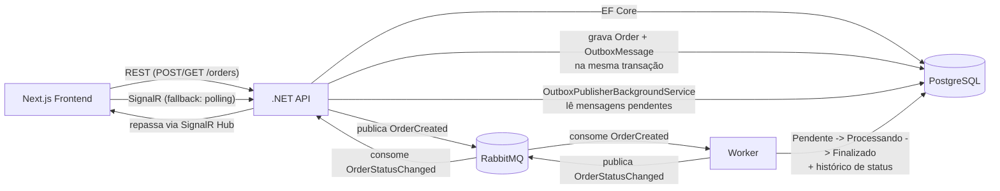

# Arquitetura

## Visão geral



## Camadas do backend (.NET)

```
OrderManagement.Domain          Entidades puras: Order, OrderStatus, OrderStatusHistory, OutboxMessage, ProcessedMessage
       ^
OrderManagement.Application     Casos de uso (OrderService) e portas/interfaces (IOrderRepository, IOutboxWriter, ...)
       ^
OrderManagement.Infrastructure  EF Core (Npgsql), RabbitMQ.Client, OutboxPublisherBackgroundService
       ^
OrderManagement.Api / Worker    Dois processos finos que compõem Domain+Application+Infrastructure
```

- **Api**: expõe os endpoints REST, aplica migrations automáticas no startup, hospeda o SignalR Hub e dois background services (`OutboxPublisherBackgroundService`, `OrderStatusChangedRelayConsumer`).
- **Worker**: consome `OrderCreated`, conduz a sequência de status e publica `OrderStatusChanged` para a Api repassar via SignalR.

## Catálogo e formação de preço

`Order.Create(customer, product)` recebe a entidade `Product` e copia nome e preço para o pedido. São duas decisões separadas:

- **O preço nunca vem da requisição.** `POST /orders` aceita `customer` e `productId`; `OrderService` carrega o produto do catálogo e é dele que sai o valor. Um cliente não consegue informar quanto o próprio pedido vale.
- **O pedido guarda um snapshot.** Nome e valor ficam gravados na linha do pedido, além da FK `ProductId`. Reajustar um produto não altera o valor dos pedidos já feitos — o histórico financeiro continua verdadeiro.

O catálogo é semeado via migration (`HasData`, ids fixos), então qualquer ambiente sobe com os mesmos produtos.

## Outbox Pattern

1. `OrderService.CreateOrderAsync` grava `Order` + `OrderStatusHistory` (Pendente) + `OutboxMessage` em uma única chamada `SaveChangesAsync` — atomicidade garantida pela transação implícita do EF Core. Nenhuma chamada ao RabbitMQ acontece nesse momento.
2. `OutboxPublisherBackgroundService` faz polling periódico na tabela `OutboxMessages` (`ProcessedAt IS NULL`), publica no RabbitMQ com *publisher confirms* e só então marca a mensagem como processada. Falhas de publish incrementam `Attempts`/`Error` para retry no próximo ciclo.

Isso garante que a criação do pedido no banco e a publicação do evento nunca fiquem "meio feitas": ou ambas acontecem, ou nenhuma.

## Idempotência do Worker (duas camadas)

1. **Nível de broker**: tabela `ProcessedMessages` guarda o `MessageId` do AMQP já tratado — cobre redelivery do RabbitMQ (at-least-once).
2. **Nível de domínio**: `Order.TransitionTo(status)` é um no-op se o pedido já está no status pedido — cobre qualquer reprocessamento, mesmo de uma mensagem "nova".

## Plano de processamento (simulador)

Cada pedido guarda um `ProcessingPlan` — duração e desfecho — gravado inline na própria linha de `Orders`. O default reproduz o enunciado (5s → `Finalizado`); os outros desfechos levam a `Falhou` ou `Cancelado`.

A máquina de estados fica assim:

```
Pendente ──► Processando ──► Finalizado     (caminho obrigatório do desafio)
   │              ├────────► Falhou          (worker não concluiu)
   └──────────────┴────────► Cancelado       (desistiu antes de concluir)
```

`Finalizado` continua alcançável **somente** por `Pendente → Processando → Finalizado`. `Falhou` e `Cancelado` são finais e não têm saída — `Order.IsTerminal` deriva disso, e a tabela de transições permitidas é a única fonte da verdade.

O preço de modelar o plano por pedido (em vez de uma configuração global) é uma coluna a mais; o ganho é poder ter vários pedidos com durações e destinos diferentes em voo ao mesmo tempo, que é o que o painel mostra e o que torna o caminho de falha reproduzível em vez de teórico.

## Sequência de status e o delay de processamento

`Pendente -> Processando` ocorre imediatamente ao consumir `OrderCreated`. `Processando -> Finalizado` ocorre 5s depois, via `Task.Delay` no próprio consumer. Como esse delay é apenas em memória, um `StuckOrdersSweeper` (BackgroundService separado) finaliza periodicamente qualquer pedido que esteja em `Processando` há mais de 5s — rede de segurança para o caso de o Worker reiniciar durante a espera, sem depender de plugins extras do RabbitMQ (como `delayed-message-exchange`).

## Tracing ponta a ponta

Dois pontos do fluxo perdem o contexto de trace por natureza, e cada um tem um mecanismo próprio:

- **Outbox (assíncrono no tempo)**: `OrderService` grava o `traceparent` da requisição na coluna `TraceParent` da linha de outbox. O `OutboxPublisherBackgroundService` usa esse valor como pai explícito do span de publish, então a publicação — que acontece segundos depois, em outro contexto de execução — continua no trace do `POST /orders` em vez de abrir um novo.
- **RabbitMQ (assíncrono no espaço)**: o contexto é injetado nos headers AMQP e extraído pelo consumidor, nos dois sentidos (Api→Worker via `OrderCreated`, Worker→Api via `OrderStatusChanged`).

A finalização após 5s também recebe o contexto do consumo como pai explícito, já que roda em uma task desacoplada depois do span de consumo ter terminado.

O `BackgroundPollSampler` descarta spans de banco órfãos: o publisher faz polling a cada 2s e o Npgsql emite um span por query, que sem requisição em curso viraria um trace raiz e soterraria os traces de pedido. Spans de query aninhados em um trace real continuam sendo gravados.

## Módulo IA/Analytics

`IOrderAnalyticsAssistant` (porta na camada Application) tem duas implementações: `ClaudeOrderAnalyticsAssistant` (API da Anthropic) e `OllamaOrderAnalyticsAssistant` (modelo local). A escolha acontece uma única vez, no registro de DI; nada acima da porta sabe qual está ativo.

O que é comum aos dois vive em `OrderAnalyticsToolset`: as definições das cinco ferramentas, o system prompt e a execução contra o banco. Os adaptadores só traduzem isso para o formato de cada provedor e conduzem o próprio loop — adicionar um terceiro provedor não duplicaria nenhum schema nem nenhuma regra de parsing.

As ferramentas expostas são um conjunto fechado, cada uma mapeada para uma query parametrizada em `IOrderAnalyticsQueries` — o modelo escolhe filtros, nunca a query. É a diferença entre "a LLM decide o que perguntar" e "a LLM decide como consultar o banco": a segunda abriria superfície de injeção e acesso a dados não previstos.

O módulo é opcional: sem provedor configurado a porta reporta `IsEnabled = false`, o endpoint responde `503` e o restante do sistema não é afetado.

## Real-time com fallback

O Worker publica `OrderStatusChanged` em uma fila própria; a Api consome essa fila e repassa via SignalR Hub (`/hubs/orders`) para os clientes conectados. No frontend, `useOrderRealtime` tenta abrir a conexão SignalR e, se falhar ou cair, cai automaticamente para polling (a cada 3s) até a conexão ser restabelecida — a UI mostra qual dos dois modos está ativo.
