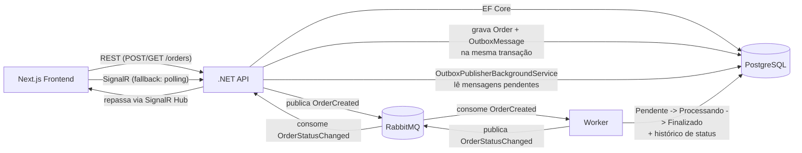

# Arquitetura

## Visão geral



## Camadas do backend (.NET)

```
OrderManagement.Domain          Entidades puras: Order, OrderStatus, OrderStatusHistory, OutboxMessage, ProcessedMessage
       ^
OrderManagement.Application     Casos de uso (OrderService) e portas/interfaces (IOrderRepository, IOutboxWriter, ...)
       ^
OrderManagement.Infrastructure  EF Core (Npgsql), RabbitMQ.Client, OutboxPublisherBackgroundService
       ^
OrderManagement.Api / Worker    Dois processos finos que compõem Domain+Application+Infrastructure
```

- **Api**: expõe os endpoints REST, aplica migrations automáticas no startup, hospeda o SignalR Hub e dois background services (`OutboxPublisherBackgroundService`, `OrderStatusChangedRelayConsumer`).
- **Worker**: consome `OrderCreated`, conduz a sequência de status e publica `OrderStatusChanged` para a Api repassar via SignalR.

## Outbox Pattern

1. `OrderService.CreateOrderAsync` grava `Order` + `OrderStatusHistory` (Pendente) + `OutboxMessage` em uma única chamada `SaveChangesAsync` — atomicidade garantida pela transação implícita do EF Core. Nenhuma chamada ao RabbitMQ acontece nesse momento.
2. `OutboxPublisherBackgroundService` faz polling periódico na tabela `OutboxMessages` (`ProcessedAt IS NULL`), publica no RabbitMQ com *publisher confirms* e só então marca a mensagem como processada. Falhas de publish incrementam `Attempts`/`Error` para retry no próximo ciclo.

Isso garante que a criação do pedido no banco e a publicação do evento nunca fiquem "meio feitas": ou ambas acontecem, ou nenhuma.

## Idempotência do Worker (duas camadas)

1. **Nível de broker**: tabela `ProcessedMessages` guarda o `MessageId` do AMQP já tratado — cobre redelivery do RabbitMQ (at-least-once).
2. **Nível de domínio**: `Order.TransitionTo(status)` é um no-op se o pedido já está no status pedido — cobre qualquer reprocessamento, mesmo de uma mensagem "nova".

## Sequência de status e o delay de 5s

`Pendente -> Processando` ocorre imediatamente ao consumir `OrderCreated`. `Processando -> Finalizado` ocorre 5s depois, via `Task.Delay` no próprio consumer. Como esse delay é apenas em memória, um `StuckOrdersSweeper` (BackgroundService separado) finaliza periodicamente qualquer pedido que esteja em `Processando` há mais de 5s — rede de segurança para o caso de o Worker reiniciar durante a espera, sem depender de plugins extras do RabbitMQ (como `delayed-message-exchange`).

## Real-time com fallback

O Worker publica `OrderStatusChanged` em uma fila própria; a Api consome essa fila e repassa via SignalR Hub (`/hubs/orders`) para os clientes conectados. No frontend, `useOrderRealtime` tenta abrir a conexão SignalR e, se falhar ou cair, cai automaticamente para polling (a cada 3s) até a conexão ser restabelecida — a UI mostra qual dos dois modos está ativo.
